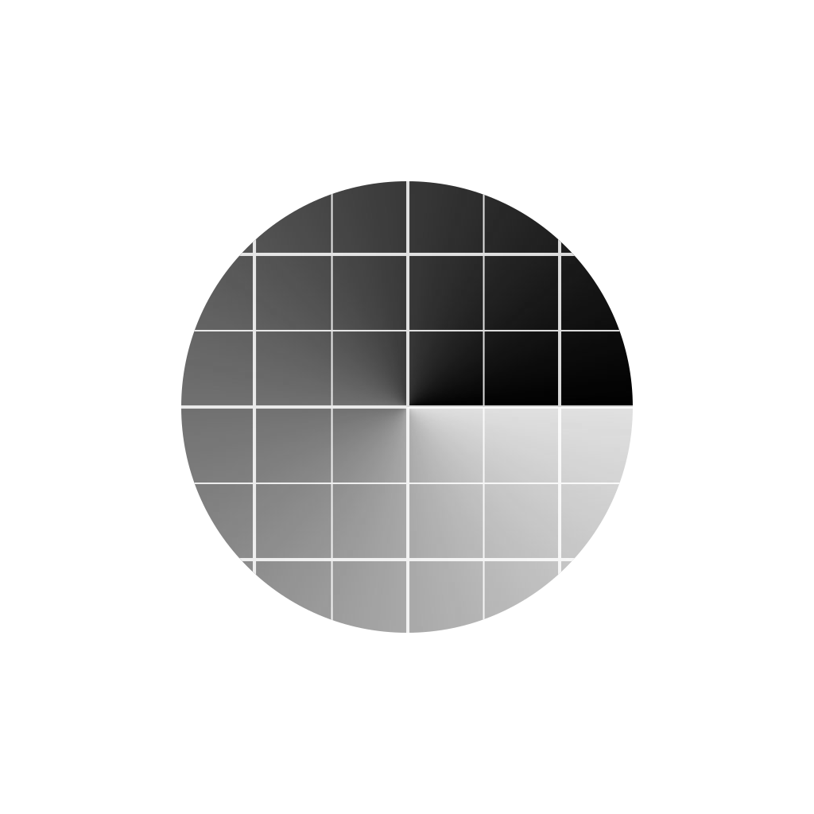

<p align="center">
  
</p>

<h1 align="center">Chrynalogia</h1>

<p align="center">
  <a href="README.md">English</a> · <strong>한국어</strong>
</p>

<p align="center">
  삼성 카메라와 Expert RAW 미리보기 위에 구도 그리드를 표시하는 앱입니다. 카메라의 촬영 기능을 그대로 사용하면서 원하는 그리드로 구도를 잡을 수 있습니다.
</p>

## 주요 기능

- 3분할법, 황금비 격자, 황금 나선, 대각선, 동적 대칭, 커스텀 직각 격자
- 여러 그리드 동시 표시와 SVG·PNG·JPEG·WebP 파일 가져오기
- 선 색상, 불투명도, 두께, 대비 아웃라인 조절
- 카메라 안에서 그리드 숨기기·회전·반전 — 그리드 영역의 터치는 카메라에 전달
- 항상 켜기·수동 실행, 한국어·영어, 시스템·밝은·어두운 테마

## 지원 환경

Android 14 이상에서 최신 One UI의 삼성 카메라와 Expert RAW를 대상으로 개발합니다. **Galaxy S23 / One UI 8.5**에서 검증했으며 다른 기기는 아직 확인하지 않았습니다. Expert RAW는 지원 기기에 별도로 설치해야 합니다. One UI가 아닌 기기에는 첫 실행 안내를 표시하지만 특수한 환경을 위해 사용을 차단하지 않습니다. 다른 카메라 앱은 지원하지 않습니다.

## 사용 방법

1. APK를 직접 설치합니다. 플레이스토어에는 배포하지 않습니다.
2. 그림으로 된 설정 안내를 따라 다른 앱 위에 표시를 허용하고 접근성에서 **Chrynalogia**를 켭니다.
3. **항상 켜기** 또는 **수동으로 켜기**를 선택합니다. 수동 실행에는 알림 권한도 필요합니다.
4. 삼성 카메라나 Expert RAW를 열고 Chrynalogia 로고를 눌러 그리드 메뉴를 사용합니다. Expert RAW가 설치되어 있으면 앱에 전용 실행 버튼도 표시됩니다.

그리드는 화면에만 표시되며 저장되는 사진에는 포함되지 않습니다. 접근성은 기기 안에서 카메라 UI를 감지하는 데 사용하며 화면이나 사진을 업로드하지 않습니다.

### Google Play 프로텍트 안내

> [!note]
> 접근성 서비스를 사용하는 앱이므로 브라우저·파일 관리자를 통한 _**설치가 Play 프로텍트에 차단될 수 있습니다.**_ 차단 검토를 요청하는 이의신청을 준비하고 있습니다. 검토가 끝날 때까지 양해 부탁드리며, 승인 여부와 시점은 확정되지 않았습니다.

Play 프로텍트는 켜 두는 것을 권장합니다. 신뢰하는 릴리즈 APK를 설치하기로 선택한 경우 아래 설정을 일시적으로 변경할 수 있습니다.

1. **Google Play 스토어 → 우측 상단 프로필 아이콘 → Play 프로텍트 → 오른쪽 위 설정**을 엽니다.
2. **Play 프로텍트로 앱 검사**를 끄고, 확인이나 본인 인증이 나오면 직접 진행합니다.
3. APK를 설치한 뒤 **Play 프로텍트로 앱 검사**를 다시 켭니다.

## 빌드

Windows에서 PowerShell과 JDK 17 이상을 준비한 뒤 실행합니다.

```powershell
.\scripts\Bootstrap.ps1
.\scripts\Release.ps1
```

서명된 릴리즈 APK: `artifacts/Chrynalogia-v1.1.0.apk`. 첫 빌드에서 생성되는 `.signing` 폴더는 별도로 안전하게 백업해 주세요. 이후 업데이트에도 같은 서명 키가 필요하며 이 폴더는 Git에서 제외됩니다.

디버그 빌드는 `.\scripts\Build.ps1`로 만듭니다. 첫 릴리즈는 서명이 다르므로 기존 디버그 앱을 삭제한 뒤 설치해야 합니다.

[디자인 기준](DESIGN.md) · [개발·검증 기록](docs/DEVELOPMENT.ko.md)
